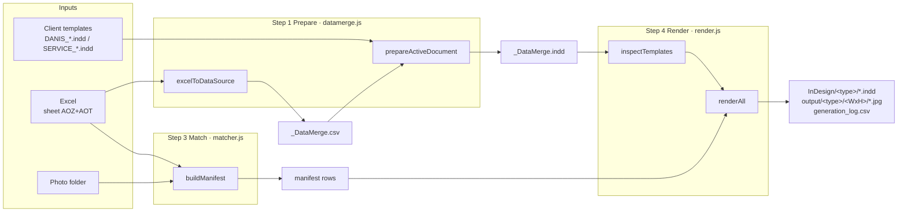
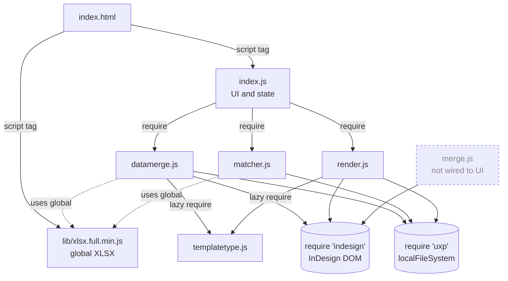
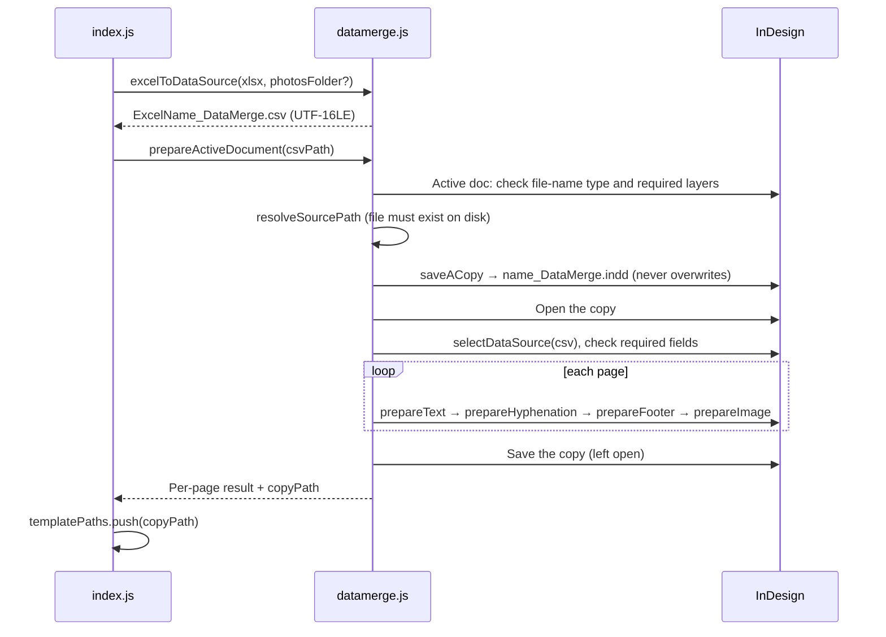
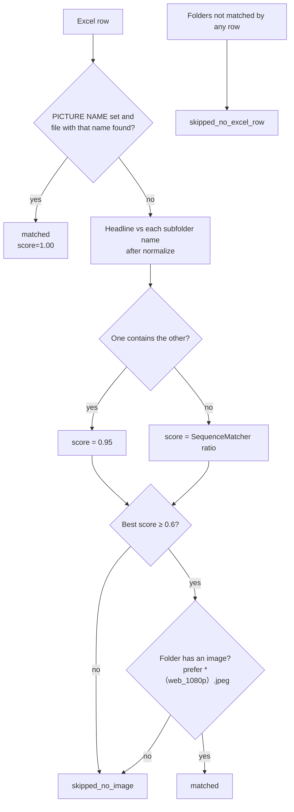
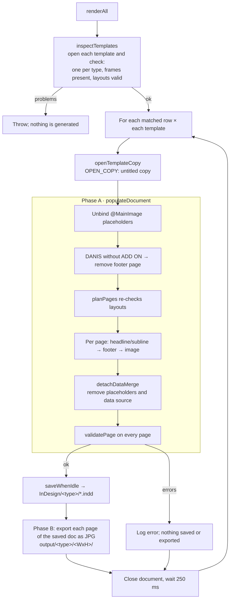

# Architecture

This document is for developers working on `plugin/`. It covers the tech stack, what each module does, how data flows between them, the template contract, and the key design decisions. For installation and usage, see the [README](../README.md).

---

## Contents

1. [Tech stack](#1-tech-stack)
2. [Overview](#2-overview)
3. [Modules and dependencies](#3-modules-and-dependencies)
4. [Panel state](#4-panel-state-indexjs)
5. [Template contract](#5-template-contract)
6. [Stage internals](#6-stage-internals)
7. [Output and logging](#7-output-and-logging)
8. [InDesign UXP DOM workarounds](#8-indesign-uxp-dom-workarounds)
9. [Design principles](#9-design-principles)
10. [Extension guide](#10-extension-guide)
11. [Known issues and tech debt](#11-known-issues-and-tech-debt)
12. [Legacy pipeline (`system/`)](#12-legacy-pipeline-system)

---

## 1. Tech stack

### At a glance

 Layer | Technology | Version / notes 

 Host application,  Adobe InDesign  ≥ 18.0 (InDesign 2023); developed and tested on InDesign 2026 
 Plugin platform,  Adobe UXP (Unified Extensibility Platform)  Manifest v5, panel plugin 
 Language,  JavaScript (ES2017+) | `async/await`, optional chaining `?.`, spread, `Set`; CommonJS-style `require` / `module.exports` 
 UI , HTML + CSS , Plain HTML elements, no UI framework, no Spectrum Web Components 
 Excel parsing , SheetJS (`xlsx.full.min.js`) , 0.20.3, vendored in `plugin/js/lib/`, Apache-2.0 licence 
 Dev , loading tool , Adobe UXP Developer Tool , Installed via Creative Cloud; loads and hot-reloads the plugin 
 OS , macOS , The only platform used so far; path handling assumes `/` 
 Runtime asset , Audi Type font (Extended Bold) , Required; checked when the panel starts 

**Not used:** build tools (Webpack, Vite, etc.), `package.json`, npm dependencies, TypeScript, automated tests, CI, servers or network requests. The plugin folder *is* the source and is loaded directly.

### Platform APIs

 API | Used for | Where 

 `require("indesign")` | InDesign DOM: open/save/export documents, pages, layers, frames, Data Merge, fonts | `datamerge.js`, `render.js`, `merge.js` |
 `require("uxp").storage.localFileSystem` | File/folder pickers, reading Excel, creating folders, writing CSV and logs | `index.js`, `matcher.js`, `datamerge.js`, `render.js` |
 `require("uxp").entrypoints` | Registering the panel and its `show()` lifecycle | `index.js` |
 `require("os")` | Home directory, to expand `~/` paths | `datamerge.js` |

### InDesign features used

- **Data Merge:** `dataMergeProperties.selectDataSource()`, `dataMergeTextPlaceholders`, `dataMergeImagePlaceholders`. Used only to *mark* slots in the template; "Create Merged Document" is not used (see [6.3](#63-render-renderjs)).
- **Documents:** `saveACopy`, `open` (with `OpenOptions.OPEN_COPY`), `save`, `close`
- **Export:** `exportFile(ExportFormat.JPG)` at 72 dpi, RGB, maximum quality
- **Image fitting:** `FitOptions.CONTENT_AWARE_FIT` (Adobe Sensei), falling back to fill proportionally + centre
- **Text:** editing via story / paragraph, enabling hyphenation

### Permissions (`manifest.json`)

```json
"requiredPermissions": {
  "localFileSystem": "fullAccess",
  "launchProcess": { "schemes": ["file"] }
}
```

- `localFileSystem: fullAccess` is needed to read and write any user-chosen folder (the copy next to the template, the CSV next to the Excel file, the output folder).
- `launchProcess` is declared but not currently used by any code.

### File formats

 Format | Direction | Notes 

 `.indd` | read / write | Client templates, `_DataMerge.indd`, per-product output 
 `.xlsx` | read | Parsed with SheetJS, sheet `AOZ+AOT` 
 `.csv` | write | Data Merge source, **UTF-16LE** so German characters survive 
 `.jpg` `.jpeg` `.png` `.tif` `.tiff` `.psd` | read | Product images (`.psd` only recognised by Prepare) 
 `.jpg` | write | Poster output 
 `generation_log.csv` | write | Run log 

### Development environment

 Need | Notes 

 Adobe InDesign 2023+ | Runs the plugin 
 UXP Developer Tool | Add Plugin → `plugin/manifest.json` → Load; click Reload after editing code 
 Any code editor | No install or compile step 
 Debugging | **Debug** in UXP Developer Tool opens DevTools with `console.log` output (`render.js` text diagnostics are printed there) 
 Font | Audi Type; otherwise the panel warns and output will be wrong 

### Why these choices

- **UXP rather than ExtendScript:** UXP is Adobe's current plugin platform, with modern JavaScript, HTML panels and `async/await`. ExtendScript is ES3-era technology that Adobe no longer develops.
- **Vendored SheetJS:** UXP has no npm build pipeline; a single standalone `.min.js` is the simplest option and needs no network.
- **No build step:** few modules and a small codebase (~2,700 lines excluding SheetJS); loading the source directly keeps development and debugging simple.
- **Data Merge as slot markers:** designers can see in InDesign which field each frame holds, and can preview with InDesign's own Data Merge panel.

---

## 2. Overview

The plugin is a **UXP panel** (HTML + JS) running inside InDesign. `index.html` loads SheetJS and `index.js` via `<script>` tags; `index.js` then loads the other modules with `require()`.

The workflow has three stages. Each stage's output is either on disk or shown in the panel, so it can be checked by a person:

 Stage | Input | Output | Module 

 **Prepare** (panel step 1) | Client `.indd` + Excel | `<name>_DataMerge.indd` + `<Excel name>_DataMerge.csv` | `datamerge.js` 
 **Match** (steps 2–3) | Excel + photo folder | In-memory manifest rows (shown in the panel table) | `matcher.js` 
 **Render** (step 4) | `_DataMerge.indd` + manifest rows | Per-product `.indd` + JPGs + `generation_log.csv` | `render.js` 



---

## 3. Modules and dependencies



 Module | Responsibility | Exports 

 `index.js` | Wires buttons, holds session state, shows progress and results; no business logic | — (registers the `posterBatchPanel` panel) 
 `datamerge.js` | Excel → CSV conversion; turns a copy of the client template into a Data Merge template | `excelToDataSource()`, `prepareActiveDocument()` 
 `matcher.js` | Reads Excel rows and finds an image for each | `buildManifest()`, `normalize()`, `sequenceMatcherRatio()` 
 `render.js` | Checks templates, populates per product, saves INDD, exports JPGs, writes the log, checks the font | `renderAll()`, `writeLog()`, `checkAudiFont()`, `debugModuleShape()` 
 `templatetype.js` | The **single** rule for telling DANIS from Service by file name | `detectTemplateType()` 
 `merge.js` | Appends pages from several `.indd` files to the active document | `mergeTemplates()` (**not called anywhere**) 
 `lib/xlsx.full.min.js` | SheetJS, third party | global `XLSX` 

**Isolated loading:** `index.js` `require`s each module inside its own `try/catch`. If one fails, a red banner appears at the top of the panel, but every other button keeps working. `render.js` and `datamerge.js` also call `require("indesign")` lazily inside functions, so file pickers and matching still work even if the InDesign DOM is temporarily unavailable.

---

## 4. Panel state (`index.js`)

All state lives in module-level variables in `index.js` and **exists only for the current panel session**. Reloading the panel clears it.

 Variable | Set by | Used for 

 `dmCsvEntry` | Step 1 Excel/CSV picker | Prepare's data source 
 `excelEntry`, `photosEntry` | Step 2 | Match input; `photosEntry` is also used by Prepare to fill `@MainImage` 
 `manifestRows` | Match result | Render input 
 `templatePaths` | Appended after each successful Prepare | Templates used by Render 
 `outputEntry` | Step 4 | Output root folder 

Button enable rules:

- **Match:** `excelEntry && photosEntry`
- **Generate:** at least one `matched` row && `outputEntry` && non-empty `templatePaths`

> There is **no** "select an existing `_DataMerge.indd`" button. `templatePaths` can only be filled by running Prepare in the current session.

**Startup:** `uxp.entrypoints.setup()` registers the panel, and `init()` runs from its `show()` callback. It shows any module load errors, polls with `waitForInDesign()` (up to 10 s) until `require("indesign").app` is available, then runs the font check. Registering `entrypoints.setup()` matters: without it, `app` can stay `undefined` indefinitely.

---

## 5. Template contract

This is the "interface" between Prepare and Render. Prepare **converts** a client template into this contract; Render only **reads** it.

### 5.1 How Prepare finds frames (client template)

For each page and each role:

1. If the page has a frame named `<<Headline>>` / `<<Footer>>` / `<<MainImage>>`, use it.
2. Otherwise look on the role's layer: first the page's own items, then items from its parent (master) page, which are first `override`n onto the page.
3. The layer must hold exactly one matching frame (zero is also fine for footer). More than one is an error. **Frames are never chosen by size or position.**

 Role | Layer | Frame type | Data Merge field written 

 Headline + subline | `text` | TextFrame | Paragraph 1 → `DANIS + SERVICE HEADLINE +PRODUCT NAMING`; paragraph 2 → `DANIS SUBLINE` or `SERVICE SUBLINE` 
 Footer | `footer` (optional) | TextFrame | Whole frame → `DANIS ADD ON` (only if the data source has that column) 
 Main image | `Image` | Rectangle / Polygon / Oval | `@MainImage` (sample image removed; fitting set to fill proportionally + centre) 

Prepare also turns on **hyphenation** for every paragraph on the `text` layer, and warns if the text has no language set (InDesign won't hyphenate without one).

### 5.2 How Render finds frames (prepared template)

Render finds `<<Headline>>`, `<<Footer>>` and `<<MainImage>>` **by name only**; it no longer looks at layers. So Render only works with templates that went through Prepare.

### 5.3 Page layout rules (`render.js` → `OUTPUT_RULES`)

`pageLayout()` classifies each page:

- **Size:** page `bounds` in pt (exported at 72 dpi, so 1 pt = 1 px)
- **Variant**, checked in order:
  1. DANIS and the page has a `<<Footer>>` frame → `footer`
  2. Service and the size is 250×250 → `thumbnail`
  3. Otherwise, the vertical centre of `<<Headline>>`: upper half of the page → `up`, lower half → `bottom`

```
DANIS    1200x1200 : up, bottom (required)  + footer (optional)
Service  250x250   : thumbnail
         800x600   : up, bottom
         1080x1920 : up, bottom
         1200x1200 : up, bottom
```

`planPages()` checks that every page fills exactly one slot. A missing required layout, a duplicate, or an unexpected size or variant is a template error.

### 5.4 Template type

`templatetype.js` looks only at the **file name** (path stripped, case-insensitive): contains `DANIS` → danis; contains `SERVICE` → service; both or neither → error. `Denis` is deliberately not accepted. Prepare and Render share this one function, so a template can never be classified differently in the two steps.

---

## 6. Stage internals

### 6.1 Prepare (`datamerge.js`)



Key points:

- **The client file is never modified:** a copy is saved first and all work happens on the copy.
- **The CSV is UTF-16LE** so InDesign Data Merge reads German characters correctly.
- The `@MainImage` column holds the full image path (matched on `PICTURE NAME`) if a photo folder was already picked; otherwise it is empty. Prepare only needs the column to exist.
- Text is replaced using **story offsets**: characters are deleted one by one and the placeholder inserted, keeping the paragraph's return so the placeholder inherits the paragraph's style. The subline is done before the headline so the headline's paragraph index stays valid.
- Locked layers and items are unlocked for editing and re-locked afterwards.
- Errors are recorded per page and per step; one failing page doesn't stop the others.

### 6.2 Match (`matcher.js`)

`matcher.js` is a JS port of the legacy `system/scripts/01_build_manifest.py` with the same rules, including a line-for-line port of `difflib.SequenceMatcher.ratio()`.



- `normalize()`: lowercase, `ä→ae ö→oe ü→ue ß→ss`, any non-alphanumeric run becomes a space.
- Folder names have a leading `01_` number and a part number (5+ alphanumeric chars) stripped first.
- Read-only: never writes to the Excel file or photo folder.

**Manifest row shape:**

```js
{
  headline, picture_name, danis_subline, danis_addon, service_subline, year,
  imagePath,    // full image path
  imageEntry,   // UXP file entry
  status,       // "matched" | "skipped_no_image" | "skipped_no_excel_row"
  notes         // e.g. "folder='…' score=0.95"
}
```

### 6.3 Render (`render.js`)



Key points:

- **InDesign's "Create Merged Document" is not used.** The Data Merge placeholders are only markers in the template. Render fills each product itself, then detaches Data Merge and saves a plain `.indd`. This gives one INDD per product and lets the DANIS footer page be kept or dropped per product.
- **Save first, export second:** JPGs are exported from the document that was just saved, so the INDD and JPGs always match.
- **Text is replaced whole-paragraph:** always through `parentStory`, never `frame.paragraphs` (which only covers text *visible* in the frame; when the long placeholder oversets, the subline would be missed). Paragraph indices are re-resolved after every change and the written text is read back and verified.
- **Images:** `CONTENT_AWARE_FIT` first; if unsupported, fill proportionally + centre. The log records which one was used.
- **Validation:** a missing image or wrong text is an error (not saved); overset text is a warning (saved, logged as `WARNING`).
- **File names:** the `productToken()` rule is shared by INDD and JPG names; `uniqueName()` adds `-2`, `-3`… for duplicates within a run; writing an INDD to the same path as a template is refused.
- **Progress:** each product × template counts as (number of JPGs + 1 INDD) operations; on failure the remaining count is added at once so the progress bar never stalls.

---

## 7. Output and logging

```
<output root>/
  generation_log.csv
  InDesign/{DANIS,Service}/<Prefix>_<year>_<product>.indd
  output/{DANIS,Service}/<WxH>/<Prefix>_<year>_<product>_<WxH>_<variant>.jpg
```

- `Prefix`: `DANIS_Herbst` / `Service_Herbst` (`PROJECT_PREFIX`)
- `generation_log.csv` columns: `timestamp, headline, page_label, output_file, status, message`
  - `info` rows: each template's layout mapping, and before/after text diagnostics for each page (`TEXT_DIAGNOSTICS = true`, marked as temporary in the code)
  - `success` / `error` rows: one per INDD and one per JPG
  - Commas inside fields are replaced with semicolons

---

## 8. InDesign UXP DOM workarounds

Much of the code that looks unnecessary is there to work around how the current InDesign UXP DOM actually behaves (the code comments say these were "confirmed empirically"). Keep them when changing related code:

 Problem | Workaround | Where 

 `require("indesign").app` can be empty right after the panel loads | `indesign()` re-`require`s until `app` exists; `waitForInDesign()` polls | all modules / `index.js` 
 `doc.pages[i]` returns `undefined`, but `allPageItems` is a plain array | `itemAt()` picks `.item(i)` or `[i]` depending on the collection | `datamerge.js`, `render.js`, `merge.js` 
 No ExtendScript `File` / `Folder` classes | Paths are plain strings; folders and files are created with `uxp.storage.localFileSystem` | `render.js` 
 Percent-encoded paths are written literally into file names (`ä` → `%C3%A4`) | `fileUrl()` uses `"file:" + path` with no encoding | `render.js` 
 Saving right after edits fails with "open transactions" | `saveWhenIdle()` yields and retries up to 20 times | both modules 
 Back-to-back open/close occasionally gives "Object is invalid" | `settle(250)` after each close; one retry on open | `render.js` 
 Paragraph/range references go invalid across edits | Use story offsets; re-resolve references after every change | `datamerge.js`, `render.js` 
 Some Data Merge placeholders have no `remove()` | `tryRemove()` is best-effort and never throws; per-page content validation is the real guard | `render.js` 
 `doc.fullName` / `filePath` come back in varying shapes | `resolveSourcePath()` tries every shape and checks the file exists | `datamerge.js` 
 `require()` relative paths resolve from the plugin root | `index.js` uses `./js/xxx.js`; `templatetype.js` is tried with both paths | `index.js`, both modules 

---

## 9. Design principles

Principles that recur throughout the code:

1. **Never guess:** frames are found by exact name or layer, and a wrong count is an error; template type comes only from the file name. Better to stop with an error than to produce a wrong poster.
2. **Never touch sources:** client templates are only copied; Render opens templates with `OPEN_COPY` and never saves back; Excel and photos are read-only.
3. **Validate before output:** all templates are checked before generating; each product is validated before saving, and exported only after saving.
4. **Shared rules live in one place:** template type (`templatetype.js`) and product file names (`productToken()`).
5. **Isolate failures:** module loading, each Prepare page, each product × template and each JPG catch their own errors, so one failure doesn't stop the rest, and every failure is logged.

---

## 10. Extension guide

 To change | Edit 

 Output sizes / layouts | `render.js` → `OUTPUT_RULES` (and the variant logic in `pageLayout()` if needed) 
 Output file name prefix | `render.js` → `PROJECT_PREFIX` 
 Output folder names | `render.js` → `TYPE_FOLDER` 
 Excel column names | `matcher.js` → `COLS` in `readExcelRows()`; `datamerge.js` → `FIELD_NAMES` and `CSV_COLUMNS` (all three must agree) 
 Sheet name | `SHEET_NAME` in both `matcher.js` and `datamerge.js` 
 Layer names | `datamerge.js` → `LAYERS` 
 A third template type | `templatetype.js` + subline field choice in `datamerge.js` + `OUTPUT_RULES` / `PROJECT_PREFIX` / `TYPE_FOLDER` in `render.js` 
 Image matching rules | `matcher.js` → `IMAGE_PREFERENCE`, `EXCLUDE_PATTERNS`, `MATCH_THRESHOLD` 
 Required font | `render.js` → `AUDI_FONT_NAME` 

---

## 11. Known issues and tech debt

- **Duplicated constants and helpers:** `SHEET_NAME`, `FRAME_NAMES`, `saveWhenIdle()`, `pathExists()`, `itemAt()` and `unlockAll()` each exist in more than one module, so changes are easy to miss. Consider a shared module.
- **Template list is not persisted:** `templatePaths` lives only in memory. After reloading the panel, Prepare must be run again, creating another `_DataMerge_N.indd` each time. Preparing the same template type twice in one session makes Render fail with "more than one template". A "select existing template" button would fix both.
- **Temporary diagnostics still on:** `TEXT_DIAGNOSTICS = true` writes large text snapshots to the log; `debugModuleShape()` is also temporary.
- **`merge.js` is unused:** there is no UI entry point for it.
- **Inconsistent image fitting:** Prepare sets fill proportionally + centre on the frame; Render prefers Content-Aware Fit.
- **Excel is parsed in two places:** `matcher.js` and `datamerge.js` each read Excel, with different required columns (`PICTURE NAME` is only required by Prepare).
- **Unused permission:** `launchProcess` is declared in `manifest.json` but never used.
- **Outdated `plugin/README.md`:** describes an earlier UI (template import in step 1) and old folder names, and lists SheetJS as MIT; it should be removed in favour of the root README.

---

## 12. Legacy pipeline (`system/`)

The command-line version that preceded the plugin, kept for reference. It **does not run as-is**: scripts hard-code old paths (`02_System/`, `01_Assets/`, `/Users/wpp88766/...`), and the folder has since been renamed to `system/`. Its template contract (page labels such as `top_service` in `Poster_Master.indd`) and output naming also differ from the plugin.

 Technology | Used for 

 Python 3 + `openpyxl` | `01_build_manifest.py`: reads Excel, matches images, writes `manifest.csv`; matching uses the standard-library `difflib` 
 ExtendScript (`.jsx`, legacy InDesign scripting) | `02_generate_posters.jsx`: reads the manifest and renders posters 
 Bash + AppleScript (`osascript`) | `run_batch.sh`: runs both steps, telling InDesign 2026 to execute the `.jsx` via AppleScript 
