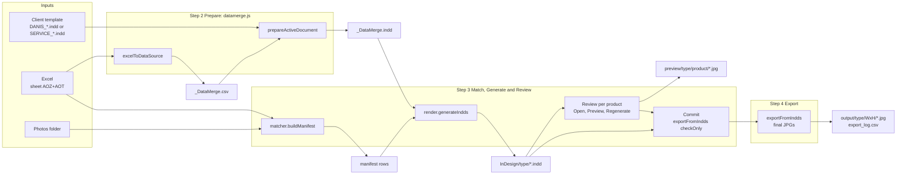
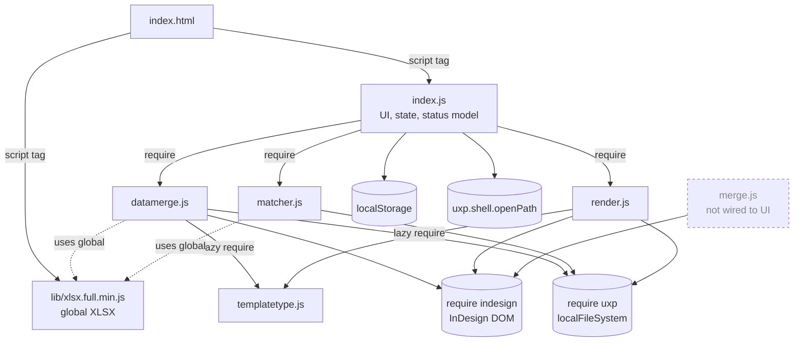
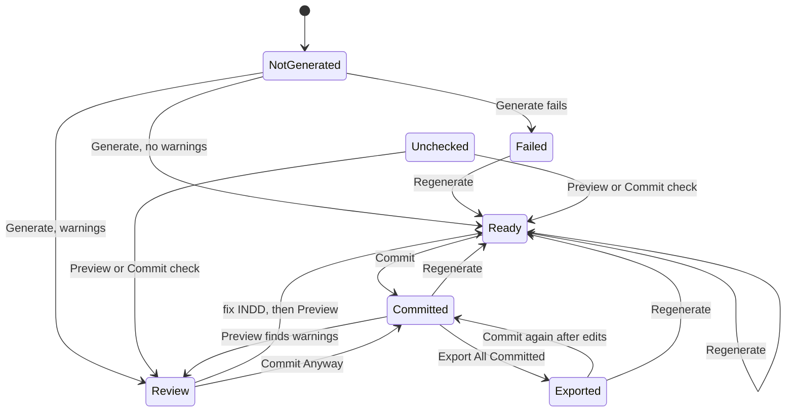
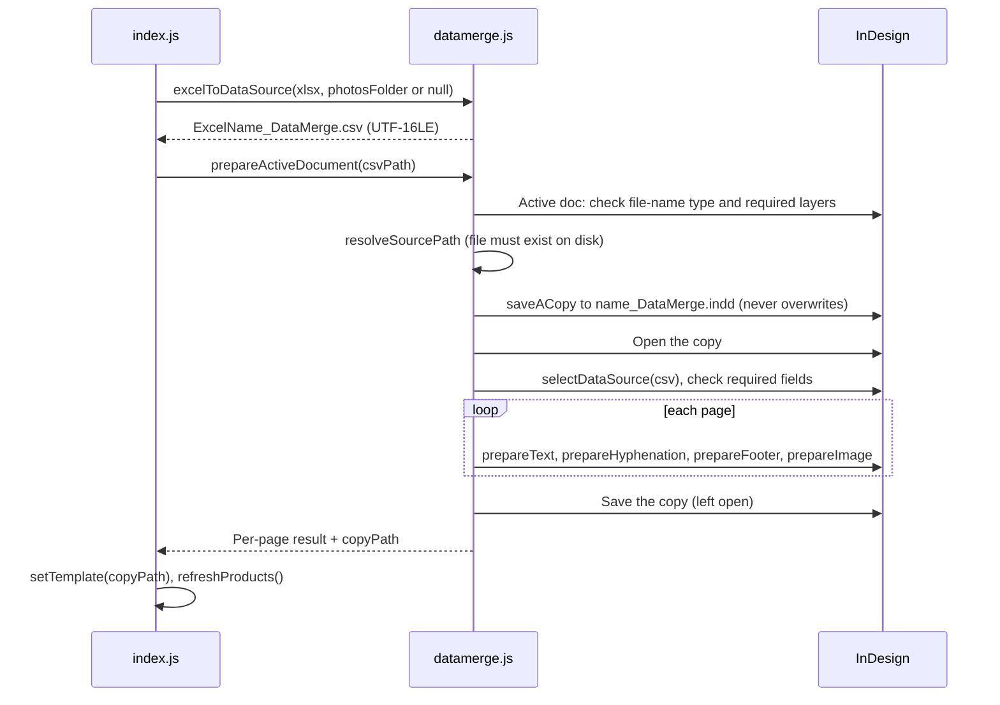
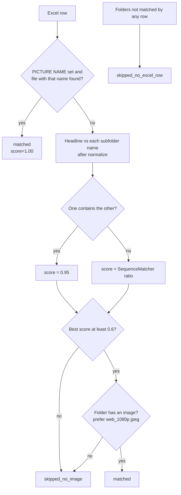
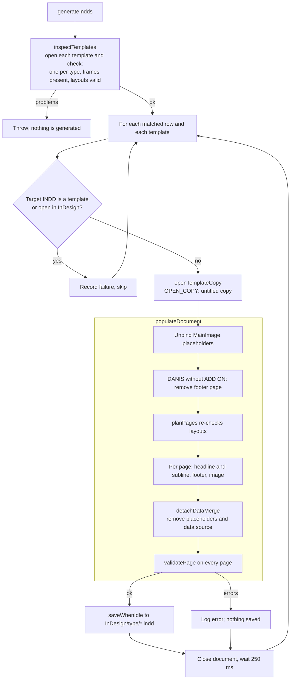
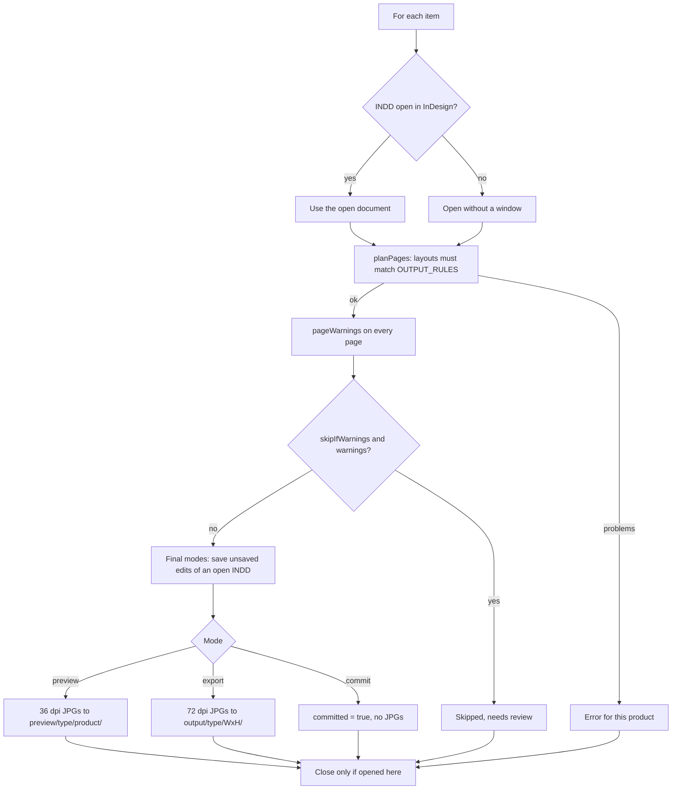

# Architecture

This document is for developers working on `plugin/`. It covers the tech stack, what each module does, how data flows between them, the product status model, the template contract and the key design decisions. For installation and usage, see the [README](../README.md).

---

## Contents

1. [Tech stack](#1-tech-stack)
2. [Overview](#2-overview)
3. [Modules and dependencies](#3-modules-and-dependencies)
4. [Panel state and persistence](#4-panel-state-and-persistence-indexjs)
5. [Product status model](#5-product-status-model)
6. [Template contract](#6-template-contract)
7. [Stage internals](#7-stage-internals)
8. [Output and logging](#8-output-and-logging)
9. [InDesign UXP workarounds](#9-indesign-uxp-workarounds)
10. [Design principles](#10-design-principles)
11. [Extension guide](#11-extension-guide)
12. [Known issues and tech debt](#12-known-issues-and-tech-debt)
13. [Legacy pipeline (`system/`)](#13-legacy-pipeline-system)

---

## 1. Tech stack

### At a glance

- **Host application:** Adobe InDesign 18.0 or later (InDesign 2023); developed and tested on InDesign 2026.
- **Plugin platform:** Adobe UXP (Unified Extensibility Platform), manifest v5, one panel entry point (`posterBatchPanel`).
- **Language:** JavaScript (ES2017+): `async/await`, optional chaining, spread, `Set`, `Map`; CommonJS-style `require` / `module.exports`.
- **UI:** plain HTML + CSS. No UI framework, no Spectrum Web Components. One native `<dialog>` for menus and confirmations.
- **Excel parsing:** SheetJS (`xlsx.full.min.js`) 0.20.3, vendored in `plugin/js/lib/`, Apache-2.0 licence.
- **Persistence:** `localStorage` (panel selections and per-product statuses).
- **Dev loading tool:** Adobe UXP Developer Tool, installed via Creative Cloud; loads and hot-reloads the plugin.
- **OS:** macOS, the only platform used so far; path handling assumes `/`.
- **Runtime asset:** Audi Type font (Extended Bold), required; checked when the panel starts.

**Not used:** build tools (Webpack, Vite, etc.), `package.json`, npm dependencies, TypeScript, automated tests, CI, servers or network requests. The plugin folder *is* the source and is loaded directly.

### Platform APIs

- **`require("indesign")`:** InDesign DOM: open, save, close and export documents; pages, layers, frames, Data Merge, fonts. Used in `datamerge.js`, `render.js`, `merge.js`, and in `index.js` only to wait for `app`.
- **`require("uxp").storage.localFileSystem`:** file and folder pickers, reading Excel, checking paths, creating folders, writing the CSV and logs. Used in `index.js`, `matcher.js`, `datamerge.js`, `render.js`.
- **`require("uxp").shell.openPath`:** opens the preview folder and the output folder in Finder. Used in `index.js`.
- **`require("uxp").entrypoints`:** registers the panel and its `show()` lifecycle. Used in `index.js`.
- **`localStorage` and `location.reload()`:** remembered selections and statuses; the Reload button. Used in `index.js`.
- **`require("os")`:** home directory, to expand `~/` paths. Used in `datamerge.js`.

### InDesign features used

- **Data Merge:** `dataMergeProperties.selectDataSource()`, `dataMergeTextPlaceholders`, `dataMergeImagePlaceholders`. Used only to *mark* slots in the template; "Create Merged Document" is not used (see [7.3](#73-generate-renderjs-generateindds)).
- **Documents:** `saveACopy`, `open` (with a window, without a window, and with `OpenOptions.OPEN_COPY`), `save`, `close`, `modified`, `activeDocument`.
- **Export:** `exportFile(ExportFormat.JPG)`, RGB, maximum quality; 72 dpi for final JPGs, 36 dpi for previews.
- **Image fitting:** `FitOptions.CONTENT_AWARE_FIT` (Adobe Sensei), falling back to fill proportionally + centre.
- **Text:** editing via story and paragraph, enabling hyphenation, overset detection (`frame.overflows`).

### Permissions (`manifest.json`)

```json
"requiredPermissions": {
  "localFileSystem": "fullAccess",
  "launchProcess": {
    "schemes": ["file"],
    "extensions": [".jpg", ""]
  }
}
```

- `localFileSystem: fullAccess` is needed to read and write any user-chosen folder (the copy next to the template, the CSV next to the Excel file, the output folder).
- `launchProcess` is used by `uxp.shell.openPath()` to reveal the preview folder after **Preview Image Batch** and the output folder from the **⋯** menu. The empty extension allows folders to be opened.

### File formats

- **`.indd`, read and write:** client template (read only), `<name>_DataMerge.indd` (the prepared template), one product INDD per product.
- **`.xlsx`, read:** parsed with SheetJS, sheet `AOZ+AOT`.
- **`.csv`, write:** the Data Merge source `<Excel name>_DataMerge.csv`, encoded **UTF-16LE with BOM** so German characters survive.
- **`.jpg .jpeg .png .tif .tiff`, read:** product images (`.psd` is also recognised by Prepare when filling `@MainImage`).
- **`.jpg`, write:** preview JPGs (36 dpi) and final JPGs (72 dpi).
- **`generation_log.csv` and `export_log.csv`, write:** run logs.

### Development environment

- **Adobe InDesign 2023+:** runs the plugin.
- **UXP Developer Tool:** Add Plugin, select `plugin/manifest.json`, then Load. Click Reload after editing code.
- **Any code editor:** no install or compile step.
- **Debugging:** **Debug** in UXP Developer Tool opens DevTools with `console.log` output (the `render.js` text diagnostics are printed there).
- **Font:** Audi Type must be installed; otherwise the panel shows a warning and output will be wrong.

### Why these choices

- **UXP rather than ExtendScript:** UXP is Adobe's current plugin platform, with modern JavaScript, HTML panels and `async/await`. ExtendScript is ES3-era technology that Adobe no longer develops.
- **Vendored SheetJS:** UXP has no npm build pipeline; a single standalone `.min.js` is the simplest option and needs no network.
- **No build step:** few modules and a small codebase (about 3,600 lines of JS excluding SheetJS); loading the source directly keeps development and debugging simple.
- **Data Merge as slot markers:** designers can see in InDesign which field each frame holds, and can preview with InDesign's own Data Merge panel.
- **INDD first, JPG second:** product INDDs are the reviewable, editable artefact; JPGs are always exported from them, so manual fixes reach the delivered images.

---

## 2. Overview

The plugin is a **UXP panel** (HTML + JS) running inside InDesign. `index.html` loads SheetJS and `index.js` via `<script>` tags; `index.js` then loads the other modules with `require()`.

The workflow is **mass generation with individual exception handling**: every product is generated in one batch, then each product can be reviewed, fixed, re-checked and approved on its own before the final export.

The panel has four steps:

1. **Inputs:** Excel file, photos folder, output folder.
2. **Template:** Prepare a copy of the client document that is open in InDesign.
3. **Match, Generate and Review:** match Excel rows to photos, generate one INDD per product, then review each product (open, preview, regenerate, commit).
4. **Export:** export the final JPGs of every committed product. This step sits in a footer bar that is always visible.

The stages behind these steps:

- **Prepare** (step 2). Input: client `.indd` + Excel (+ optional photos folder). Output: `<name>_DataMerge.indd` + `<Excel name>_DataMerge.csv`. Module: `datamerge.js`.
- **Match** (step 3). Input: Excel + photos folder. Output: in-memory manifest rows, shown as the product list. Module: `matcher.js`.
- **Generate** (step 3). Input: `_DataMerge.indd` + manifest rows. Output: one product `.indd` per matched row + `generation_log.csv`. Module: `render.js` (`generateIndds`).
- **Preview** (step 3, per product). Input: product `.indd`. Output: low-resolution JPGs in `preview/`. Module: `render.js` (`exportFromIndds`, preview mode).
- **Commit** (step 3, per product or all Ready). Input: product `.indd`. Output: the INDD saved and checked, status set to Committed; no JPGs. Module: `render.js` (`exportFromIndds`, check-only mode).
- **Export** (step 4). Input: committed product `.indd` files. Output: final JPGs in `output/` + `export_log.csv`. Module: `render.js` (`exportFromIndds`, export mode).



---

## 3. Modules and dependencies



**`index.js`**
Wires buttons, holds session state, persists selections and statuses, owns the product status model, renders the product list and the "Working in" bar, shows progress and results. It contains no InDesign business logic. Exports nothing; registers the `posterBatchPanel` panel.

**`datamerge.js`**
Converts Excel to the merge CSV and turns a copy of the client template into a Data Merge template. Exports `excelToDataSource()` and `prepareActiveDocument()`.

**`matcher.js`**
Reads Excel rows and finds an image for each. Exports `buildManifest()`, `normalize()` and `sequenceMatcherRatio()`.

**`render.js`**
Checks templates, generates and validates product INDDs, exports preview and final JPGs from them, manages open documents, writes logs and checks the font. Exports:

- Generation and export: `generateIndds()`, `exportFromIndds()`, `writeLog()`
- Document handling: `openIndd()`, `isInddOpen()`, `closeIndd()`, `activeDocumentPath()`
- Paths and types: `inddPathFor()`, `outputFolderFor()`, `pathExists()`, `typeOfTemplate()`, `TYPE_FOLDER`
- Startup and diagnostics: `checkAudiFont()`, `debugModuleShape()`

**`templatetype.js`**
The **single** rule for telling DANIS from Service by file name. Exports `detectTemplateType()`.

**`merge.js`**
Appends pages from several `.indd` files to the active document. Exports `mergeTemplates()`, which is **not called anywhere**.

**`lib/xlsx.full.min.js`**
SheetJS, third party. Provides the global `XLSX`.

**Isolated loading:** `index.js` `require`s each module inside its own `try/catch`. If one fails, a red banner appears at the top of the panel, but every other button keeps working. `render.js` and `datamerge.js` also call `require("indesign")` lazily inside functions, so file pickers and matching still work even if the InDesign DOM is temporarily unavailable.

---

## 4. Panel state and persistence (`index.js`)

### In-memory state

All state lives in module-level variables in `index.js`:

- **`excelEntry`, `photosEntry`, `outputEntry`:** set by the step 1 pickers. `excelEntry` is the input for both Prepare and Match; `photosEntry` is used by Match and, if already chosen, by Prepare to fill `@MainImage`.
- **`templatePaths`:** the prepared template set. It holds **one** template; preparing another one replaces it (`setTemplate()`). The template decides the output type (DANIS or Service) for the whole run.
- **`manifestRows`:** the Match result; the product list renders from it.
- **`products`:** a `Map` from each matched row to `{ inddPath, subType, exists }`, built by `refreshProducts()` from the current template, output folder and `render.inddPathFor()`. Rebuilt after Match, Prepare, choosing an output folder, and every Generate.
- **`statuses`:** per-product status records (see [section 5](#5-product-status-model)).
- **`activeRec`:** the row whose INDD is InDesign's front document, if any.
- **`busy`:** true while Prepare, Match, Generate, Preview, Commit or Export runs, so runs cannot overlap. Every action button is disabled while busy.

### Persistence (`localStorage`)

Selections and statuses survive closing and reopening the panel. Keys (`STORE`):

- `posterBatch.excelPath`, `posterBatch.photosPath`, `posterBatch.outputPath`
- `posterBatch.templatePaths` (only the last entry is restored)
- `posterBatch.inddStatuses`

`restoreSelections()` turns each remembered path back into a UXP entry with `getEntryWithUrl("file:" + path)`; a path that no longer exists is dropped silently. Manifest rows are **not** persisted, so Match must be run again after the panel is reopened. Once it has run, INDDs generated in an earlier session show up again with their remembered status.

### Reload button

**⟳ Reload** returns the panel to a clean start: it clears every `STORE` key, all in-memory state, messages and progress, then calls `location.reload()`. Files on disk are never touched. Because the panel is already visible after a reload, its `show()` callback may not fire again, so a `posterBatch.reloading` flag in `localStorage` makes the reloaded script call `init()` itself. Reload is refused while a run is in progress.

### Button enable rules

- **Prepare Copy of Current Document:** an Excel file is selected.
- **Match:** Excel file and photos folder are selected.
- **Generate All .indd:** at least one `matched` row, an output folder and a prepared template.
- **Commit All Ready .indd:** at least one product in the Ready state.
- **Export All Committed Images:** an output folder and at least one product in the Committed state.
- **Per product:** **Open .indd** appears only when the INDD exists; **Preview Image Batch** and **Commit .indd** need an existing INDD; **⋯** needs a product mapping (template and output folder set).

### Startup

`uxp.entrypoints.setup()` registers the panel, and `init()` runs once from its `show()` callback. It shows any module load errors, restores selections, polls with `waitForInDesign()` (up to 10 s) until `require("indesign").app` is available, then runs the font check. Registering `entrypoints.setup()` matters: without it, `app` can stay `undefined` indefinitely. After a panel reload `setup()` may throw because it can only be registered once per plugin load; this is caught and ignored.

### UI building blocks

- **Product list (`renderTable()`):** one block per manifest row: product name and status, detail lines (image file name, errors, up to `MAX_WARNINGS` warnings, commit or export time), then the actions. Details are shown inline because UXP panels do not reliably show hover tooltips.
- **"Working in" bar:** `pollActiveDocument()` runs every second (skipped while busy). When InDesign's front document is one of the product INDDs, its row is highlighted and its Preview, Commit and **⋯** buttons appear in the footer bar. Polling is used because this UXP DOM has no reliable document activation event.
- **Dialog (`showDialog()`):** one `<dialog>` serves the **⋯** menu and every confirmation, because UXP panels have no reliable dropdown menus or `window.confirm()`. It uses `uxpShowModal()` where available and resolves only after the modal has fully closed (plus 100 ms), since UXP refuses to open a second modal while the first is still closing.
- **Progress channels:** two progress bars and message areas. The **generate** channel sits under the product list and is used by Generate, Regenerate and Commit; the **export** channel sits in the footer and is used by Preview and Export. Progress shows only while a run is going; afterwards `summarize()` shows a headline plus at most five failures.

---

## 5. Product status model

Each product INDD has a status record in `statuses`, keyed by its lowercased path:

```js
{
  status,       // "ready", "review" or "failed"
  warnings,     // string[] from the latest check
  error,        // last error text, or ""
  committedAt,  // ISO time set by Commit, or null
  exportedAt,   // ISO time set by Export, or null
  updatedAt     // ISO time of the last change
}
```

`rowState()` combines the manifest row, the `products` map and the record into the state shown in the list:

- **No asset:** the row is not `matched` (no image, or a folder with no Excel row). No actions.
- **Not generated:** no INDD on disk for this product.
- **Failed:** the latest generation failed (an older INDD may still be on disk).
- **Unchecked:** an INDD exists but has no record (for example generated before a Reload). It is **not** treated as Ready.
- **Ready:** the latest check found no warnings.
- **Review:** the latest check found warnings (empty image frame, overset text).
- **Committed:** saved, checked and approved by the designer; queued for export.
- **Exported:** final JPGs exist.



How each action updates the record:

- **Generate / Regenerate (`recordGeneration()`):** a generated INDD becomes `ready` or `review` and clears `committedAt` and `exportedAt`. A failure becomes `failed`, except when the INDD was skipped because it is open in InDesign; then the old record is kept.
- **Preview:** sets `ready` or `review` from the fresh check. If warnings are found, `committedAt` and `exportedAt` are cleared, so a problem found after Commit needs a new Commit.
- **Commit:** sets `committedAt` when committed (otherwise null) and clears `exportedAt`.
- **Export:** sets `exportedAt` for each product whose pages all exported.
- An outcome with an error and no warnings (the INDD could not be checked) leaves the old record unchanged.

**Commit rules:**

- **Single Commit** first runs with `skipIfWarnings: true`. If the product has warnings, the panel lists them and asks **Commit Anyway**; only then does it run again without the check.
- **Commit All Ready** commits only products in the Ready state, with `skipIfWarnings: true`; products that now show warnings are skipped and become Review.
- **Export All Committed** never skips for warnings; that decision was made at Commit.

---

## 6. Template contract

This is the "interface" between Prepare and the later stages. Prepare **converts** a client template into this contract; Generate, Preview, Commit and Export only **read** it.

### 6.1 How Prepare finds frames (client template)

For each page and each role:

1. If the page has a frame named `<<Headline>>`, `<<Footer>>` or `<<MainImage>>`, use it.
2. Otherwise look on the role's layer: first the page's own items, then items from its parent (master) page, which are first `override`n onto the page.
3. The layer must hold exactly one matching frame (zero is also fine for footer). More than one is an error. **Frames are never chosen by size or position.**

The roles:

- **Headline + subline:** layer `text`, a TextFrame. Paragraph 1 becomes `DANIS + SERVICE HEADLINE +PRODUCT NAMING`; paragraph 2 becomes `DANIS SUBLINE` or `SERVICE SUBLINE`, depending on the template type.
- **Footer:** layer `footer` (optional), a TextFrame. The whole frame becomes `DANIS ADD ON`, but only if the data source has that column.
- **Main image:** layer `Image`, a Rectangle, Polygon or Oval. Becomes `@MainImage`; the sample image is removed and fitting is set to fill proportionally + centre.

A missing `text` or `Image` layer is an error; a missing `footer` layer is only a warning. Prepare also turns on **hyphenation** for every paragraph on the `text` layer, and warns if the text has no language set (InDesign will not hyphenate without one).

### 6.2 How later stages find frames (prepared template and product INDDs)

`render.js` finds `<<Headline>>`, `<<Footer>>` and `<<MainImage>>` **by name only**; it does not look at layers. So it only works with templates that went through Prepare, and with product INDDs generated from them. A designer editing a product INDD must keep these frame names.

### 6.3 Page layout rules (`render.js`, `OUTPUT_RULES`)

`pageLayout()` classifies each page:

- **Size:** page `bounds` in pt (final JPGs are exported at 72 dpi, so 1 pt = 1 px).
- **Variant**, checked in order:
  1. DANIS and the page has a `<<Footer>>` frame: `footer`
  2. Service and the size is 250x250: `thumbnail`
  3. Otherwise, the vertical centre of `<<Headline>>`: upper half of the page is `up`, lower half is `bottom`

```
DANIS    1200x1200 : up, bottom (required)  + footer (optional)   -> 2 or 3 JPGs
Service  250x250   : thumbnail
         800x600   : up, bottom
         1080x1920 : up, bottom
         1200x1200 : up, bottom                                   -> 7 JPGs
```

`planPages()` checks that every page fills exactly one slot. A missing required layout, a duplicate, or an unexpected size or variant is a template error. The same check runs on the template (before generating), on each populated working copy, and on each product INDD before Preview, Commit or Export.

### 6.4 Template type

`templatetype.js` looks only at the **file name** (path stripped, case-insensitive): contains `DANIS` gives danis; contains `SERVICE` gives service; both or neither is an error. `Denis` is deliberately not accepted. Prepare and Render share this one function, so a template can never be classified differently in the two steps. The prepared copy is named `<client name>_DataMerge.indd`, so it classifies like the client file.

---

## 7. Stage internals

### 7.1 Prepare (`datamerge.js`)



Key points:

- **The client file is never modified:** a copy is saved first and all work happens on the copy. If `name_DataMerge.indd` exists, `_DataMerge_2`, `_DataMerge_3` and so on are used.
- **The CSV is UTF-16LE with BOM** so InDesign Data Merge reads German characters correctly. It is written next to the Excel file and overwritten each time.
- **Required columns for the CSV:** headline, `DANIS SUBLINE`, `SERVICE SUBLINE`, `PICTURE NAME`; `DANIS ADD ON` is optional and left out of the CSV when the sheet has no such column. `@MainImage` is always added.
- The `@MainImage` column holds the full image path (matched on `PICTURE NAME`) if a photos folder was already picked; otherwise it is empty. Prepare only needs the column to exist.
- Text is replaced using **story offsets**: characters are deleted one by one and the placeholder inserted, keeping the paragraph's return so the placeholder inherits the paragraph's style. The subline is done before the headline so the headline's paragraph index stays valid.
- Locked layers and items are unlocked for editing and re-locked afterwards.
- Errors are recorded per page and per step; one failing page does not stop the others. The panel shows one line per page, with the problems of any failed page.

### 7.2 Match (`matcher.js`)

`matcher.js` is a JS port of the legacy `system/scripts/01_build_manifest.py` with the same rules, including a line-for-line port of `difflib.SequenceMatcher.ratio()`.



- Columns are found by header name. `DANIS SUBLINE` and `SERVICE SUBLINE` are required; if the headline header is not found, column 0 is used. Rows with an empty headline are skipped. `n/a` cells are treated as empty; an empty `YEAR` defaults to the current year.
- `normalize()`: lowercase, `ä` to `ae`, `ö` to `oe`, `ü` to `ue`, `ß` to `ss`, and any run of non-alphanumeric characters becomes a space.
- Folder names have a leading `01_` number and a part number (5+ alphanumeric characters) stripped first.
- Files named like `Bildschirmfoto*` and hidden files are excluded.
- Read-only: never writes to the Excel file or photos folder.

**Manifest row shape:**

```js
{
  headline, picture_name, danis_subline, danis_addon, service_subline, year,
  imagePath,    // full image path
  imageEntry,   // UXP file entry
  status,       // "matched", "skipped_no_image" or "skipped_no_excel_row"
  notes         // e.g. "folder='...' score=0.95"
}
```

### 7.3 Generate (`render.js`, `generateIndds`)

Used by **Generate All .indd** (all rows) and by **⋯ Regenerate .indd** (one row). No JPGs are produced here.



Key points:

- **InDesign's "Create Merged Document" is not used.** The Data Merge placeholders are only markers in the template. Generate fills each product itself, then detaches Data Merge and saves a plain `.indd`. This gives one INDD per product and lets the DANIS footer page be kept or dropped per product.
- **Existing INDDs are replaced.** Generate All asks for confirmation when any product INDD already exists, because manual edits will be lost. Regenerate asks too, and if the INDD is open it is closed **without saving** first, then the new INDD is opened in InDesign.
- **Open INDDs are never overwritten by Generate All:** a product whose INDD is open is reported as failed and its status is kept.
- **Text is replaced whole-paragraph:** always through `parentStory`, never `frame.paragraphs` (which only covers text *visible* in the frame; when the long placeholder oversets, the subline would be missed). Paragraph indices are re-resolved after every change and the written text is read back and verified. If placeholder text survives, the native placeholders are removed and the write is retried once.
- **Images:** `CONTENT_AWARE_FIT` first; if unsupported, fill proportionally + centre. The log records which one was used.
- **Validation:** a missing image, the wrong image, wrong text or extra paragraphs is an error (nothing saved); overset text is a warning (saved, status Review).
- **File names:** `productToken()` is shared by INDD and JPG names; `uniqueName()` adds `-2`, `-3` and so on for duplicates within a run; writing an INDD to the same path as a template is refused.
- **Progress:** one operation per product and template.

### 7.4 Preview, Commit and Export (`render.js`, `exportFromIndds`)

One function handles all three actions, for one product or many. It always works on the product INDD **as it is now**, so manual edits are included.



- **Options:** `preview` (low-res JPGs, nothing saved), `checkOnly` (Commit: save and check, no JPGs), `skipIfWarnings` (do nothing for a product with warnings).
- **What counts as a warning (`pageWarnings()`):** an empty `<<MainImage>>` frame, or headline, subline or footer text that does not fit its frame. Text is **not** compared with the Excel here, because it may have been edited on purpose.
- **Saving:** in Commit and Export mode, an INDD that is open with unsaved edits is saved first, so the INDD and the JPGs always match. Preview never saves.
- **Open documents stay open:** an INDD the user has open is left open; one opened by the function is closed again without saving.
- **Pages are re-classified from the INDD itself,** so a DANIS INDD without a footer page yields no footer JPG.
- **Preview** writes into the same folder each time (`preview/<type>/<product>/`), overwriting the previous preview, and `index.js` opens that folder with `uxp.shell.openPath()`.
- An outcome reports `{ inddPath, exported, committed, warnings, error, folder }`. A product counts as exported only if every page exported.

---

## 8. Output and logging

```
<output root>/
  generation_log.csv         written by Generate All .indd
  export_log.csv             written by Export All Committed Images
  InDesign/{DANIS,Service}/<Prefix>_<year>_<product>.indd
  preview/{DANIS,Service}/<product>/<Prefix>_<year>_<product>_<WxH>_<variant>.jpg
  output/{DANIS,Service}/<WxH>/<Prefix>_<year>_<product>_<WxH>_<variant>.jpg
```

- `Prefix`: `DANIS_Herbst` or `Service_Herbst` (`PROJECT_PREFIX`).
- `variant`: `up`, `bottom`, `footer` or `thumbnail`.
- Both logs are overwritten on every run and share the columns `timestamp, headline, page_label, output_file, status, message`.
- `status` values:
  - `info`: each template's layout mapping, per-page validation reports, before/after text diagnostics (`TEXT_DIAGNOSTICS = true`, marked as temporary in the code), and "open INDD had unsaved edits, saved".
  - `success` and `error`: one per INDD in the generation log, one per JPG in the export log.
  - `skipped`: a product skipped for warnings.
- Commas inside fields are replaced with semicolons.
- Regenerate, Preview and Commit do not write a log file; their results are shown in the panel and kept in the status record.

---

## 9. InDesign UXP workarounds

Much of the code that looks unnecessary is there to work around how the current InDesign UXP DOM and panel host actually behave (the code comments say these were "confirmed empirically"). Keep them when changing related code.

**`app` can be empty right after the panel loads.**
`indesign()` re-`require`s until `app` exists; `waitForInDesign()` polls before every InDesign action. All modules and `index.js`.

**`app` stays undefined unless the panel is registered.**
`uxp.entrypoints.setup()` with a `show()` callback that runs `init()`. `index.js`.

**`doc.pages[i]` returns `undefined`, but `allPageItems` is a plain array.**
`itemAt()` picks `.item(i)` or `[i]` depending on the collection. `datamerge.js`, `render.js`, `merge.js`.

**No ExtendScript `File` / `Folder` classes.**
Paths are plain strings; folders and files are created with `uxp.storage.localFileSystem`. `render.js`.

**Percent-encoded paths are written literally into file names (`ä` becomes `%C3%A4`).**
`fileUrl()` uses `"file:" + path` with no encoding. `render.js`.

**Saving right after edits fails with "open transactions".**
`saveWhenIdle()` yields and retries up to 20 times. `datamerge.js`, `render.js`.

**Back-to-back open and close occasionally gives "Object is invalid".**
`settle(250)` after each close; one retry on open. `render.js`.

**Paragraph and range references go invalid across edits.**
Use story offsets; re-resolve references after every change. `datamerge.js`, `render.js`.

**Some Data Merge placeholders have no `remove()`.**
`tryRemove()` is best-effort and never throws; per-page content validation is the real guard. `render.js`.

**`doc.fullName` and `filePath` come back in varying shapes.**
`resolveSourcePath()` (Prepare) tries every shape and checks the file exists; `documentPath()` (render) accepts a string or a File-like object. `datamerge.js`, `render.js`.

**`require()` relative paths resolve from the plugin root.**
`index.js` uses `./js/xxx.js`; `templatetype.js` is tried with both paths. `index.js`, `datamerge.js`, `render.js`.

**A second modal cannot open while the first is still closing.**
`showDialog()` resolves only after the `close` event plus 100 ms. `index.js`.

**No dropdown menus, `window.confirm()` or reliable tooltips in panels.**
One shared `<dialog>` for menus and confirmations; details are shown as inline text lines. `index.js`.

**No reliable document activation event.**
`pollActiveDocument()` checks the front document once a second. `index.js`.

**`show()` may not fire again after `location.reload()`, and `entrypoints.setup()` may throw.**
The `posterBatch.reloading` flag triggers `init()` directly; the `setup()` error is caught. `index.js`.

---

## 10. Design principles

Principles that recur throughout the code:

1. **Never guess:** frames are found by exact name or layer, and a wrong count is an error; template type comes only from the file name. Better to stop with an error than to produce a wrong poster.
2. **Never touch sources:** client templates are only copied; Generate opens templates with `OPEN_COPY` and never saves back; Excel and photos are read-only.
3. **Validate before output:** templates are checked before generating; each product is validated before its INDD is saved; every INDD is checked again before Commit and Export.
4. **The INDD is the source of truth for JPGs:** JPGs are only ever exported from saved product INDDs, so manual fixes always reach the delivered images, and INDD and JPGs always match.
5. **A person approves every delivery:** nothing is exported until it is Committed, and a product with warnings is never committed silently.
6. **Never lose edits silently:** replacing existing INDDs, regenerating, and closing an open INDD without saving all require confirmation.
7. **Shared rules live in one place:** template type (`templatetype.js`), product file names (`productToken()`), layout rules (`OUTPUT_RULES`).
8. **Isolate failures:** module loading, each Prepare page, each product and template, and each JPG catch their own errors, so one failure does not stop the rest, and every failure is logged or shown.

---

## 11. Extension guide

- **Output sizes and layouts:** `render.js`, `OUTPUT_RULES` (and the variant logic in `pageLayout()` if needed).
- **Output file name prefix:** `render.js`, `PROJECT_PREFIX`.
- **Output folder names:** `render.js`, `TYPE_FOLDER`; also the `"InDesign"`, `"output"` and `"preview"` segments in `inddPathFor()`, `outputFolderFor()`, `previewFolderFor()` and `generateIndds()`.
- **JPG resolution:** `render.js`, `FINAL_RESOLUTION` and `PREVIEW_RESOLUTION`.
- **What counts as a warning:** `render.js`, `pageWarnings()` (Preview, Commit, Export) and the warnings in `validatePage()` (Generate).
- **Excel column names:** `matcher.js`, `COLS` in `readExcelRows()`; `datamerge.js`, `FIELD_NAMES` and `CSV_COLUMNS`. All three must agree.
- **Sheet name:** `SHEET_NAME` in both `matcher.js` and `datamerge.js`.
- **Layer names:** `datamerge.js`, `LAYERS`.
- **A third template type:** `templatetype.js`, the subline field choice in `datamerge.js`, and `OUTPUT_RULES`, `PROJECT_PREFIX` and `TYPE_FOLDER` in `render.js`.
- **Image matching rules:** `matcher.js`, `IMAGE_PREFERENCE`, `EXCLUDE_PATTERNS`, `MATCH_THRESHOLD`, `CONTAINMENT_SCORE`.
- **Required font:** `render.js`, `AUDI_FONT_NAME`.
- **Product states, labels and colours:** `index.js`, `rowState()` and `STATE_LABEL`; button texts in `LABEL`.
- **Remembered settings:** `index.js`, `STORE`.
- **Number of warnings shown per product:** `index.js`, `MAX_WARNINGS`.

---

## 12. Known issues and tech debt

- **Duplicated constants and helpers:** `SHEET_NAME`, `FRAME_NAMES`, `saveWhenIdle()`, `pathExists()`, `itemAt()`, `unlockAll()`, `paragraphText()` and `nonEmptyParagraphs()` each exist in more than one module, so changes are easy to miss. Consider a shared module.
- **Duplicate product names:** `generateIndds()` gives the second product with the same file name a `-2` suffix, but `inddPathFor()` (used by the panel) does not, so both rows point at the first INDD and the `-2` file is never tracked.
- **Exact picture matches leave their folder "unmatched":** a row matched by `PICTURE NAME` does not mark its folder as used, so that folder also appears as a `skipped_no_excel_row` row.
- **Excel is parsed in two places:** `matcher.js` and `datamerge.js` each read Excel, with different required columns (`PICTURE NAME` is only required by Prepare) and different headline handling (`matcher.js` falls back to column 0).
- **One template type at a time:** the panel keeps a single prepared template, so producing DANIS and Service means preparing and running the batch once per type. `inspectTemplates()` still supports several templates. Statuses of the other type stay in storage but are not shown.
- **Status is not tied to file content:** a Committed product edited afterwards without a new Commit is still exported (Export saves open edits but does not re-check them). Statuses also do not notice INDDs changed or deleted outside the panel until the next check, and Reload clears every status, so all existing INDDs become Unchecked.
- **Manifest rows are not persisted:** Match must be run again after reopening the panel.
- **Partial logging:** only Generate All and Export write log files; Regenerate, Preview and Commit results exist only in the panel and the status record. Both logs are overwritten on each run.
- **Temporary diagnostics still on:** `TEXT_DIAGNOSTICS = true` writes large text snapshots to the generation log; `debugModuleShape()` is also temporary.
- **`merge.js` is unused:** there is no UI entry point for it.
- **Inconsistent image fitting:** Prepare sets fill proportionally + centre on the frame; Generate prefers Content-Aware Fit.
- **Outdated texts:** the font warning in `checkAudiFont()` points to the old `01_Assets/` path; the header comment of `index.js` still lists the old step order; `plugin/README.md` describes an earlier UI and old folder names and lists SheetJS as MIT. It should be removed in favour of the root README.
- **Polling:** `pollActiveDocument()` runs every second for the whole panel session.

---

## 13. Legacy pipeline (`system/`)

The command-line version that preceded the plugin, kept for reference. It **does not run as-is**: scripts hard-code old paths (`02_System/`, `01_Assets/`, `/Users/wpp88766/...`), and the folder has since been renamed to `system/`. Its template contract (page labels such as `top_service` in `Poster_Master.indd`) and output naming also differ from the plugin.

- **Python 3 + `openpyxl`:** `01_build_manifest.py` reads Excel, matches images and writes `manifest.csv`; matching uses the standard-library `difflib`.
- **ExtendScript (`.jsx`, legacy InDesign scripting):** `02_generate_posters.jsx` reads the manifest and renders posters. Older one-off fix and verify scripts are in `scripts/_archive/`.
- **Bash + AppleScript (`osascript`):** `run_batch.sh` runs both steps, telling InDesign 2026 to execute the `.jsx` via AppleScript.
